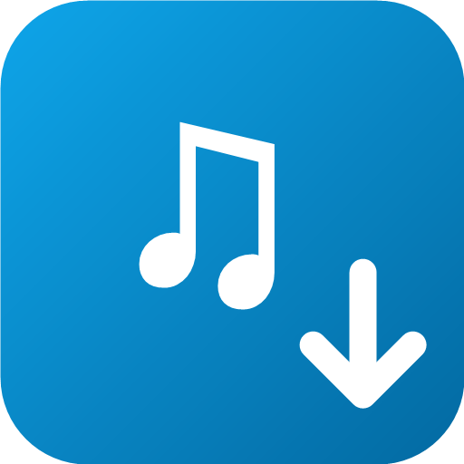

<p align="center"></p>

<h1 align="center">yt-dlp UI</h1>

<p align="center">
  App desktop para baixar playlists de música do YouTube na melhor qualidade de áudio, com capa embutida.<br>
  Uma interface para o <a href="https://github.com/yt-dlp/yt-dlp">yt-dlp</a> e o <a href="https://ffmpeg.org/">ffmpeg</a>. Gratuito e de código aberto.
</p>

<p align="center">
  <a href="https://luizcomparin.github.io/yt-dlp-ui/"><b>Página do app</b></a> ·
  <a href="https://github.com/luizcomparin/yt-dlp-ui/releases/latest/download/yt-dlp-ui-setup.exe"><b>Baixar instalador</b></a> ·
  <a href="https://github.com/luizcomparin/yt-dlp-ui/releases/latest/download/yt-dlp-ui-portable.exe">Baixar versão portátil</a>
</p>

---

## Funcionalidades

- Áudio na melhor qualidade (opus/m4a original, sem recodificar) ou no formato escolhido.
- Capa embutida (com opção de recorte quadrado) e título do vídeo no nome do arquivo.
- Lista a playlist com duração, tamanho e disponibilidade; ordena, filtra e seleciona faixas.
- Fila com pausar/retomar, downloads paralelos e erros que não travam o resto (log exportável em CSV).
- Sincronizar playlist: baixa só as faixas novas.
- Extras: `.m3u`, monitor da área de transferência, aviso de duplicadas, notificações, cookies do navegador, console para comandos avançados.

## Instalar (usuários)

Requisito: **Windows 10 ou 11, 64 bits**.

| Opção | Arquivo | Quando usar |
|---|---|---|
| **Instalador** (recomendado) | [`yt-dlp-ui-setup.exe`](https://github.com/luizcomparin/yt-dlp-ui/releases/latest/download/yt-dlp-ui-setup.exe) | Cria atalhos no Menu Iniciar e na Área de Trabalho e tem desinstalador |
| **Portátil** | [`yt-dlp-ui-portable.exe`](https://github.com/luizcomparin/yt-dlp-ui/releases/latest/download/yt-dlp-ui-portable.exe) | Arquivo único, roda sem instalar (ex.: pendrive). Abre alguns segundos mais devagar |

1. Baixe e abra o arquivo.
2. Os executáveis **não têm assinatura digital** (ela é paga). Se o Windows mostrar "O Windows protegeu o computador", clique em **Mais informações → Executar assim mesmo**.
3. Na primeira execução o painel ⚙ abre sozinho: clique em **Instalar tudo**. O app baixa o yt-dlp, o ffmpeg e o deno.
4. Cole o link da playlist, clique em **Carregar**, selecione as faixas e clique em **Baixar selecionadas**.

As músicas vão para `Música\yt-dlp-ui` (configurável). Configurações, cache, fila, logs e as ferramentas baixadas ficam em `%APPDATA%\yt-dlp UI\`.

> Se os downloads do YouTube pararem de funcionar, clique em **atualizar** ao lado do yt-dlp no painel ⚙.

## Rodar localmente (desenvolvimento)

Requisitos: **Windows 10/11 x64**, **Node.js 22.5 ou mais novo** (recomendado: 24, ver [`app/.nvmrc`](app/.nvmrc)) e **npm 10+**. Git para clonar.

```bash
git clone https://github.com/luizcomparin/yt-dlp-ui.git
cd yt-dlp-ui/app
npm install        # também baixa o binário do Electron (script postinstall)
npm run dev        # abre o app com hot reload
```

Não é preciso instalar yt-dlp, ffmpeg nem deno à mão: o app baixa tudo pelo painel ⚙ (botão **Instalar tudo**). Se você já tiver um ffmpeg no PATH (ex.: `winget install ffmpeg`), ele é detectado.

Outros comandos (em `app/`):

| Comando | O que faz |
|---|---|
| `npm test` | Testes unitários (Vitest) |
| `npm run typecheck` | Checagem de tipos do main/preload e do renderer |
| `npm run build` | Build do electron-vite em `out/` |
| `npm run preview` | Abre o app a partir do build |

## Gerar o executável

```bash
cd app
npm run dist            # dist/win-unpacked/ (pasta) + dist/yt-dlp-ui-portable.exe
npm run dist:installer  # dist/yt-dlp-ui-setup.exe (instalador NSIS)
```

- `dist\win-unpacked\yt-dlp UI.exe` é a forma que abre mais rápido: copie a pasta inteira para onde quiser e crie um atalho.
- Feche o app e não deixe nenhum terminal com o diretório atual dentro de `app/dist`, senão o build falha com `EBUSY`.

### Publicar uma versão (mantenedor)

O GitHub Actions gera e publica os executáveis sozinho quando uma tag `v*` é enviada:

```bash
cd app
npm version 0.2.0 --no-git-tag-version   # atualiza package.json e package-lock.json
git commit -am "v0.2.0"
git tag v0.2.0
git push origin main v0.2.0
```

O workflow [`release.yml`](.github/workflows/release.yml) roda typecheck e testes, gera o instalador e o portátil e cria o release. Os links `releases/latest/download/...` passam a apontar para a nova versão. Detalhes em [app/docs/modulos/distribuicao.md](app/docs/modulos/distribuicao.md).

## Dependências

### Ferramentas externas (baixadas pelo app em tempo de execução)

| Ferramenta | Versão | Para quê |
|---|---|---|
| [yt-dlp](https://github.com/yt-dlp/yt-dlp) | última estável (ou nightly, configurável) | Metadados e download |
| [ffmpeg / ffprobe](https://github.com/yt-dlp/FFmpeg-Builds) | último build `master` do yt-dlp/FFmpeg-Builds (win64, GPL) | Extração de áudio, capa embutida e recorte |
| [deno](https://deno.com/) | última estável | Runtime JS que o yt-dlp exige para o YouTube |

Essas ferramentas usam sempre a versão mais recente de propósito: o YouTube muda com frequência e um yt-dlp antigo para de funcionar. Elas **não** vêm dentro do executável. Ficam em `%APPDATA%\yt-dlp UI\bin\` e o yt-dlp pode ser atualizado pelo app.

### Pacotes npm (versões travadas no `package-lock.json`)

| Pacote | Versão | Uso |
|---|---|---|
| electron | 45.3.0 | Runtime desktop (Node 24 embutido, inclusive `node:sqlite`) |
| react / react-dom | 19.3.1 | Interface |
| zustand | 5.1.0 | Estado global da UI |
| @tanstack/react-virtual | 3.14.26 | Virtualização da lista de faixas |
| tailwindcss / @tailwindcss/vite | 4.3.5 | Estilos |
| electron-vite | 6.0.0 | Dev server e build |
| vite | 8.3.7 | Bundler |
| @vitejs/plugin-react | 6.3.0 | React no Vite |
| typescript | 7.0.2 | Tipagem |
| vitest | 5.1.0 | Testes |
| electron-builder | 26.18.0 | Pasta, portátil e instalador |
| @types/node, @types/react, @types/react-dom | 26.6.6, 19.3.0, 19.3.0 | Tipos |

Todos ficam em `devDependencies`: a UI é empacotada pelo Vite e o processo principal usa só módulos embutidos, então o executável não leva `node_modules`. Mais detalhes em [app/docs/dependencias.md](app/docs/dependencias.md).

## Documentação

A documentação técnica (arquitetura, módulos, decisões) está em [app/docs/](app/docs/README.md).

## Uso responsável

Use o app apenas com conteúdo que você tem direito de baixar, respeitando os termos do YouTube e a legislação de direitos autorais. O app não hospeda nem distribui conteúdo.

## Licença

[MIT](LICENSE) © 2026 Luiz Carlos Comparin. O yt-dlp (Unlicense), o ffmpeg (GPL) e o deno (MIT) têm licenças próprias e são baixados diretamente das fontes oficiais, não redistribuídos por este projeto.
